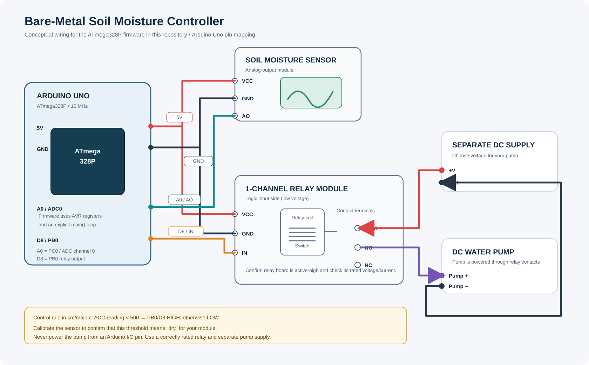

# Bare-Metal Soil Moisture Controller (ATmega328P)

A register-level AVR C project for an Arduino Uno / ATmega328P. The firmware
samples an analog soil-moisture sensor on ADC0 and drives a relay-module input
from PB0. It uses an explicit `main()` function and AVR registers rather than
the Arduino `setup()` / `loop()` API.

## Circuit diagram



The diagram is a **conceptual wiring reference** based on the pin assignments
in `src/main.c`. The original archive contained firmware but no verified
schematic or hardware-test evidence. Confirm the actual labels, voltage
requirements, relay logic, pump rating, and wiring of your particular modules
before powering the circuit.

## Pin mapping

| Function | ATmega328P signal | Arduino Uno pin |
| --- | --- | --- |
| Soil sensor analog output (AO) | ADC0 / PC0 | A0 |
| Soil sensor analog output (AO) | ADC0 / PC0 | A0 |
| Relay-module input (IN) | PB0 | D8 |
| Sensor and relay logic supply | 5V / GND rails | 5V / GND |
| ADC reference | AVcc (selected by REFS0) | AVcc is normally tied to 5V on Uno |

For the pump load, use a **separate DC supply** rated for the pump. Connect
the supply positive to the relay COM contact, relay NO to the pump positive,
and pump negative to the supply negative. This makes the pump supply pass
through the normally-open relay contact. Do not connect a pump directly to an
Arduino I/O pin or assume the Uno 5V rail can power it.

## Control logic implemented

1. The ADC uses AVcc as its reference (selected by REFS0) and reads channel 0 (A0).
2. The firmware takes an ADC sample once per loop.
3. If the ADC reading is below `DRY_THRESHOLD` (currently `500`), PB0/D8 is
   driven HIGH. Otherwise, PB0/D8 is driven LOW.
4. The loop waits approximately one second before the next reading.

**Important calibration note:** the source code calls the constant
`DRY_THRESHOLD`, but whether a reading below 500 actually means dry soil
depends on the specific sensor module, its adjustment, wiring, and soil.
Measure the sensor's readings in wet and dry soil and set the threshold
accordingly. Also confirm whether your relay module is active-high or
active-low; the current code assumes that a HIGH output activates the relay
input.

## Build (standalone AVR-GCC)

Requires `avr-gcc` and `avr-objcopy` for the ATmega328P toolchain.

```bash
./scripts/build.sh
```

The script creates:

- `build/soil-moisture-controller.elf`
- `build/soil-moisture-controller.hex`

This is a standalone AVR program with its own `main()` entry point. It is not
intended to be compiled as a regular Arduino IDE `.ino` sketch alongside the
Arduino core, which supplies its own `main()`.

## Hardware safety and validation

- Test and calibrate the sensor with the pump disconnected first.
- Verify relay-board input polarity and contact ratings from its datasheet.
- Use a correctly rated relay/driver and a separate supply appropriate for
  the pump's voltage and startup current.
- For a DC motor pump, use suitable inductive-load suppression if required by
  the pump/relay manufacturer.
- Keep the low-voltage controller wiring and pump-load wiring clearly
  separated; follow the relay module's isolation and grounding requirements.
- Hardware operation has not been verified as part of this repository review.
  The AVR toolchain was unavailable in the review environment, so a firmware
  binary build could not be run here.
